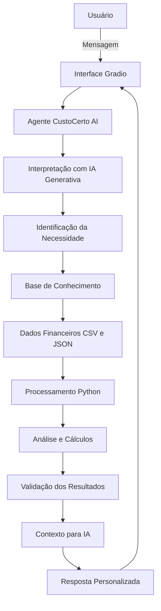

# 🤖 Documentação do Agente — CustoCerto AI

## Caso de Uso

### Problema

Muitas pessoas possuem dificuldades para organizar suas finanças, controlar despesas e identificar para onde está indo seu dinheiro ao longo do mês.

A falta de acompanhamento dos gastos pode provocar desequilíbrio financeiro, consumo excessivo e dificuldade para alcançar objetivos de economia.

Além disso, muitas ferramentas tradicionais apenas apresentam registros financeiros, sem interpretar os dados ou oferecer orientações personalizadas.

O CustoCerto AI busca resolver esse problema por meio de um agente inteligente capaz de analisar receitas, despesas e hábitos de consumo, transformando informações financeiras em recomendações úteis para o usuário.

### Solução

O CustoCerto AI é um agente financeiro desenvolvido com Python e Inteligência Artificial Generativa, especializado no controle, análise e previsão de custos mensais.

O agente utiliza informações registradas em uma base de conhecimento para identificar padrões de consumo, comparar despesas com limites de orçamento e sugerir oportunidades de economia.

Sua atuação é proativa, pois não se limita a responder perguntas. O sistema também poderá identificar possíveis excessos, alertar sobre categorias próximas do limite planejado e antecipar estimativas de gastos até o final do mês.

As principais funcionalidades são:

- Análise automática de receitas e despesas.
- Identificação das categorias com maiores gastos.
- Comparação entre despesas e orçamento planejado.
- Previsão de custos mensais.
- Identificação de possíveis excessos financeiros.
- Recomendações personalizadas de economia.
- Histórico de conversas e manutenção de contexto.
- Interação por meio de um chatbot inteligente.

Os cálculos financeiros serão realizados por funções desenvolvidas em Python, enquanto a IA Generativa será responsável por interpretar perguntas e apresentar os resultados em linguagem natural.

### Público-Alvo

O agente é destinado principalmente a:

- Pessoas que desejam organizar suas finanças pessoais.
- Usuários que possuem dificuldade para controlar despesas mensais.
- Pessoas interessadas em reduzir custos e economizar dinheiro.
- Famílias que desejam acompanhar o orçamento doméstico.
- Pessoas que buscam compreender melhor seus hábitos de consumo.

O projeto também poderá ser adaptado futuramente para atender pequenos empreendedores e profissionais autônomos que precisam acompanhar seus custos mensais.

---

## Persona e Tom de Voz

### Nome do Agente

**CustoCerto AI — Agente Inteligente de Custos Mensais.**

### Personalidade

O CustoCerto AI possui uma personalidade consultiva, educativa, amigável e analítica.

Seu comportamento é orientado à organização financeira e à identificação de oportunidades de economia.

O agente deve:

- Demonstrar interesse pela situação financeira do usuário.
- Analisar informações antes de apresentar recomendações.
- Identificar possíveis problemas no orçamento.
- Sugerir melhorias de forma construtiva.
- Evitar julgamentos sobre hábitos de consumo.
- Incentivar o planejamento financeiro consciente.
- Explicar os resultados de maneira simples.

O objetivo é atuar como um assistente financeiro digital que ajuda o usuário a compreender melhor seus custos e tomar decisões mais conscientes.

### Tom de Comunicação

O tom de comunicação será acessível, consultivo e objetivo.

O agente deverá utilizar uma linguagem simples, evitando termos técnicos desnecessários e explicando conceitos financeiros quando necessário.

As respostas deverão ser:

- Claras e diretas.
- Educativas e informativas.
- Personalizadas conforme os dados disponíveis.
- Respeitosas e sem julgamentos.
- Transparentes sobre limitações e estimativas.

### Exemplos de Linguagem

- **Saudação:** "Olá! Sou o CustoCerto AI. Estou aqui para ajudar você a organizar suas despesas e cuidar melhor do seu dinheiro. Como posso ajudar hoje?"

- **Confirmação:** "Entendi! Vou analisar suas despesas registradas e verificar onde podemos encontrar oportunidades de economia."

- **Recomendação:** "Identifiquei que seus gastos com alimentação ultrapassaram o limite planejado. Podemos avaliar algumas alternativas para reduzir esse custo no próximo mês."

- **Alerta:** "Atenção! Seus gastos com transporte estão próximos do limite mensal definido. Vale acompanhar as próximas despesas dessa categoria."

- **Erro/Limitação:** "Não encontrei informações suficientes para realizar essa análise. Você pode cadastrar suas despesas para que eu consiga ajudar?"

- **Previsão:** "Considerando o ritmo atual dos seus gastos, a estimativa indica que suas despesas poderão ultrapassar o orçamento planejado. Essa previsão pode mudar conforme os próximos lançamentos."

---

## Arquitetura

### Diagrama

### Componentes

| Componente | Descrição |
|------------|-----------|
| Interface | Chatbot interativo desenvolvido com Gradio para comunicação com o usuário. |
| LLM | Modelo de linguagem generativa integrado por meio da Gemini API. |
| Base de Conhecimento | Arquivos CSV e JSON com transações, histórico de atendimento, perfil financeiro e orçamento mensal. |
| Processamento | Funções Python responsáveis por consultar e organizar os dados financeiros. |
| Análise Financeira | Utilização de Pandas para calcular despesas, receitas, saldos e categorias de gastos. |
| Simulador | Módulo Python para estimar custos futuros e simular oportunidades de economia. |
| Memória | Armazenamento do histórico de conversas para preservar o contexto das interações. |
| Validação | Verificação dos dados e resultados calculados antes da geração das respostas. |

### Fluxo de Funcionamento

1. O usuário envia uma pergunta pela interface do CustoCerto AI.
2. O agente interpreta a intenção utilizando IA Generativa.
3. O sistema identifica quais informações financeiras são necessárias.
4. Os dados são consultados na base de conhecimento.
5. Python executa os cálculos e as análises.
6. Os resultados passam por validações.
7. A IA recebe os resultados como contexto e organiza a resposta.
8. O agente apresenta uma orientação personalizada ao usuário.
9. A interação poderá ser armazenada para utilização nas próximas conversas.

---

## Segurança e Anti-Alucinação

### Estratégias Adotadas

O CustoCerto AI utiliza estratégias para reduzir respostas incorretas e garantir que as recomendações sejam fundamentadas nas informações disponíveis.

- [x] O agente deve responder com base nos dados fornecidos pela base de conhecimento.
- [x] Os cálculos financeiros serão realizados por funções Python.
- [x] A IA não deverá inventar receitas, despesas ou transações.
- [x] Quando não possuir informações suficientes, deverá informar a limitação.
- [x] As previsões deverão ser identificadas como estimativas.
- [x] Os resultados serão validados antes de serem apresentados.
- [x] O histórico de atendimento será utilizado para contextualizar as conversas.
- [x] Dados fictícios serão utilizados durante o desenvolvimento e os testes.
- [x] Chaves de API e credenciais não serão armazenadas em arquivos públicos.
- [x] O agente não deverá solicitar senhas ou informações bancárias sigilosas.
- [x] As informações financeiras serão utilizadas somente para a finalidade do sistema.

### Tratamento de Situações Limite

**1. Ausência de dados financeiros**

Quando o usuário solicitar uma análise sem possuir transações registradas, o agente deverá informar que precisa de dados para realizar os cálculos.

**2. Informações inconsistentes**

Caso existam valores inválidos, datas incorretas ou registros incompletos, o sistema deverá identificar o problema antes de realizar a análise.

**3. Perguntas fora do contexto financeiro**

O agente deverá explicar que sua especialidade é o controle e a análise de custos mensais, direcionando a conversa para suas funcionalidades.

**4. Previsões financeiras**

O agente deverá apresentar previsões como estimativas baseadas no histórico disponível, sem tratá-las como valores garantidos.

**5. Falha na integração com a IA**

Caso a API esteja indisponível, o sistema deverá informar que a funcionalidade de conversação está temporariamente indisponível, preservando a possibilidade de executar os cálculos locais em Python.

---

## Resultado Esperado

O CustoCerto AI busca transformar o controle financeiro mensal em uma experiência mais simples, inteligente e personalizada.

Por meio da integração entre Python, análise de dados e IA Generativa, o agente será capaz de interpretar informações financeiras, identificar padrões de consumo, antecipar possíveis excessos e sugerir oportunidades de economia.

O principal diferencial da solução é combinar cálculos financeiros realizados por código com a capacidade de interpretação e comunicação da inteligência artificial, proporcionando respostas mais transparentes e fundamentadas.

---

**Projeto:** CustoCerto AI  
**Desafio:** Agente Financeiro Inteligente com IA Generativa — DIO  
**Linguagem:** Python  
**IA Generativa:** Gemini API  
**Interface:** Gradio  
**Ambiente de desenvolvimento:** Google Colab
